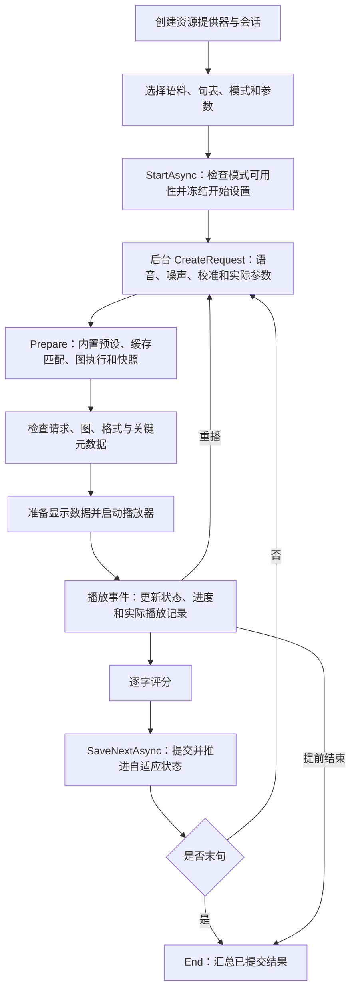

# 言语训练模块原理与流程

说明训练资源、会话生命周期、内置预设、自适应规则、显示和结果生成。API 调用与接入示例集中在训练复用指南。

核对日期：2026-11-10，以当前工作区实现为准。

相关文档：[音频处理模块复用指南](音频处理模块复用指南.md) · [言语训练模块复用指南](言语训练模块复用指南.md) · [音频处理模块原理与流程](音频处理模块原理与流程.md)。

## 生命周期与资源

FileSpeechCorpusProvider 在创建时发现语料目录、读取正文和 corpus.json，形成语料及配置快照。句表是按大小分组的视图，句子稳定 ID 不随分组改变。WAV 在请求准备时重新读取并计算文件哈希；噪声提供器对首次读取结果或失败做缓存，校准参考也来自该提供器。



会话把准备任务放在 Task.Run 中，先冻结业务选择，后台不读取可变 UI 设置。更新播放代次并取消旧请求以隔离停止、切句、退出后的晚到计算和回调。只有当前准备结果通过检查并确认启动，才开放评分。播放中可评分；纯音频会话可按 CanSaveNext 提前保存，绑定刺激输出后需等待输出完成再提交；准备失败、播放失败或中断的未完成句需要重播。

每轮开始前可设置全部训练参数，开始后界面和核心接口同时锁定人工修改；自适应算法仍可逐句调整语速或信噪比，音量、静音、评分和播放控制保持可用。`PersistAsync` 是可选的异步持久化边界：开始、逐句提交和结束均等待成功；失败时保留原提交快照、锁定评分与重播并允许重试，成功后才推进句次和自适应状态。未提交的评分不计入结果。

## 请求、预设与缓存

CreateRequest 冻结句子、业务设置、语音样本、实际自适应倍率、噪声 SNR／种子、文件和 PCM 身份。Prepare 生成或复用房间响应，由内部 TrainingAudioPreset 构建图并调用通用执行器。独立服务本身是同步 API，后台调度由 Session 负责。

缓存复用要求请求相等且构建的图等价；输入、资源身份、参数、种子、出口改变均会失效。RIR 条件相同时可以复用响应。当前句的处理 PCM、完整包络及显示结果一起复用，没有跨会话缓存。默认噪声缓存不会因磁盘文件修改而热加载。

ValidateRequest 检查请求与预设、展开节点的参数及连接、输出格式和执行记录，还核对变速、噪声及 RIR 的关键元数据。自定义准备服务也不能绕过这些检查。快照保存资源与执行摘要，不保存完整 PCM、RIR 数组或处理器实例；图中的额外源只记录格式、帧数和内容身份。文件哈希与 PCM 哈希分开，快照不支持反向执行或持久化迁移。

## 五种模式的处理路径

| 模式 | 播放路径 | 包络参考 |
| --- | --- | --- |
| FixedRate，语速为 0 | 原始语音，可选重采样和声码器 | 干净原始语音，启用声码器时同步重采样 |
| FixedRate，1～5 字/秒 | SOLAFS，可选重采样和声码器 | 共享 SOLAFS 输出 |
| AdaptiveRate | 按实际倍率 SOLAFS，可选重采样和声码器 | 共享 SOLAFS 输出 |
| FixedSnr／AdaptiveSnr | 普通加噪，可选重采样和声码器 | 原始输入的干净支路 |
| FixedRir | 16 kHz 重采样、RIR（可内部加噪）、可选声码器 | RIR dryReference，保留直达偏移和尾部零区间 |

原速是 FixedRate 的参数值，不是第六种模式。所有预设提供 playback、envelopeSource、envelope 三个固定出口。声码器只作用于播放支路，包络参考始终排除噪声与声码器。分析直接消费图的 envelope 出口，不二次提取包络。

变速比例为目标语速除以原语速；字数采用可评分字数，排除标点和空白，目标帧数为 `Round(采样率 × 字数 / 语速, AwayFromZero)`，结果不足一帧或超过可表示长度时报错，不裁剪文件中的停顿。默认 0 原速直接复用 PCM。保留原采样率、声道数；双声道以共同相关性选择同一拼接位置。

`TrainingAudioSnapshot.TimeStretch` 保存原始帧数、采样率、原始时长、原始语速、倍率、目标语速、实际输出帧数和实际语速。原始语速 = 可评分字数 / 原始音频完整时长，保留文件内停顿；目标语速 = 原始语速 × 倍率；实际语速 = 可评分字数 / SOLAFS 实际输出时长，仅体现帧数舍入差异，不包含后续重采样差异或声码器尾段。计算使用完整 double 精度，显示最多三位小数并去尾零。

通用 DSP 的重采样、RIR、噪声校准和声码器计算集中在[音频处理模块原理与流程](音频处理模块原理与流程.md)，本节仅描述训练模式如何选择和连接它们。

### 噪声资源和偏移

训练的 SSN／Babble 从 corpus.json 映射读取，MHINT-P 复用 MHINT；校准固定取 SSN-MSP。内置图用 noise-source 连接原噪声，不增加噪声预处理。普通混音以语音帧数为偏移模数，RIR 包含卷积尾部。

校准值为完整 SSN-MSP RMS 的一半。RIR 模式的训练 Noise 快照将 `NormalizationGain` 记录为 1，额外噪声增益保存在 `Rir.NoiseGain`；不能将其解释为普通混音的整体归一化增益。

会话种子的四字节小端表示与句子 ID 的 UTF-8 字节拼接后取 SHA256，取前四字节小端无符号数对混音帧数取余。这样不依赖运行时随机数版本；同句重播或换声码器不另抽噪声片段。Noise 元数据保存资源、SNR、偏移、增益等实际条件。

## 自适应规则与结果

### 自适应语速

研究实际调用链为 `SpeechIntelligibility/psychophysicsFunction.m → mySoundProcess.m → SOLA/solafs.m`。独立 `AdaptiveSpeechState` 保存 R、上次判断、反转数及不可变提交记录：

- 初始 R = 0.5，播放倍率 = 1 + R，首句为 1.5 倍。
- 会话对内置语料使用代码固定规则：MSP 为 7 字且至少答对 4 字；MHINT、MHINT-P 为 10 字且至少答对 8 字。自定义语料使用 SetScoringRule 的覆盖值或 corpus.json 的规则；缺少规则、字数不符或非法分数明确提示，开始前校验所选句表，提交时再次校验。
- 相邻两次提交判断不同时增加一次反转，首次提交不算反转。先更新反转数，再选系数：反转数小于 2 用 1.5，2～3 用 1.26，至少 4 用 1.1。通过时 R 乘系数，未通过时 R 除系数，不能直接乘除播放倍率。
- 按当前句表原顺序完成全部句子，不以反转数停止；支持现有可变句表大小及末尾不足整表。

`TrainingAudioRequest.SpeedMultiplier` 冻结自适应倍率；内置模式决定使用倍率还是固定字/秒。训练预设使用 `round(原始帧数 / 倍率)`，中点远离零，不把目标语速取整。非有限或非正倍率、空音频、结果不足一帧、不可表示的输出长度均报错，不限速或生成替代音频。

只有完整评分后的 `SaveNextAsync` 推进状态，每句只提交一次。纯音频会话允许播放中提前保存（绑定刺激输出时须等待输出完成）：捕获本次播放完成标记与实际配置，停止播放、保存评分、更新 R 后准备下一句。重播、修改或重置评分、播放失败和取消不推进；下一句准备失败后重试沿用已经确定的倍率。载体在整轮训练期间锁定，下轮开始前可重新设置。缓存包含句子及完整配置（含倍率）；取消令牌与播放代号阻止退出后的旧任务发布结果。

`AdaptiveSummary` 仅在完整提交当前句表且至少 8 句时，计算最后 8 句已提交目标语速的算术平均值。计算不使用界面舍入值，也不使用最终播放时长。提前结束为“测试未完成”；完整句表不足 8 句为“样本不足”，均保留明细但不显示阈值。实际载体配置始终一致时显示“自适应语速阈值（SRT）”；实际播放过不同载体配置时标记“混合载体”，数值只称“末 8 句平均语速（描述性）”，不能解释为单一载体条件的阈值。

### 自适应 SNR

研究依据为 `SpeechIntelligibility/psychophysicsFunction.m`、`mySoundProcess.m`、`myAddNoise.m` 和 `PrintLine.m`。评分复用每库 `adaptiveScoring`；独立 `AdaptiveSnrState` 先计算本次反转，再在反转数小于 2、小于 4、其余情况下分别选择 8、4、2 dB。通过降低 SNR，失败升高并封顶 20 dB；没有人为下限，允许负 SNR。只有完整评分保存成功才推进阶梯，重播、准备失败、载体变化及过期回调不推进。下一句加载失败不撤回已经提交的上一句。

逐句结果的 `AdaptiveSnr` 保存提交及混音快照。结果 `SnrSummary` 仅在完整提交且至少 8 句时，计算末 8 句实际提交 SNR 的算术平均，不使用下一句 SNR。提前结束显示“测试未完成”，少于 8 句显示“样本不足”，均不显示阈值。实际播放过不同声码器配置（包括同句重播、未提交句）时标记混合载体，数值仅称“末 8 句平均 SNR（描述性）”。旧记录缺失字段显示“未记录”，不从当前资源补填。

### 固定条件及实际播放记录

固定模式沿用逐字评分，不判断整句通过。设置的可选 `FixedSnrDb` 保存初始固定条件；逐句结果的通用 `Noise` 保存实际播放噪声快照。自适应 SNR 继续保留原 `AdaptiveSnr` 字段并同时填写通用快照，旧记录可以从原字段读取；不从当前目录补填历史资源信息。

结果显示固定 SNR、噪声、已完成句数、逐句得分与总正确率，分母为已提交句子的实际评分字数。提前结束标记“测试未完成”，零提交显示“待判定”；不生成 SRT、末 8 句摘要或整句通过判定。实际播放过不同声码器配置（包括未提交句及同句重播）时标记“混合载体”。旧记录缺少固定值或噪声快照时显示“未记录”。桌面应用将结果持久化为言语实验下的独立训练记录。

RIR 元数据在播放前与配置和生成结果核对；失败、取消、过期回调均不能启用评分。结果记录房间、反射开关、算法版本、完整/生效 RIR 哈希、分段位置、输出长度及增益。按已提交字数统计正确率，不生成 SRT；未完成和零提交分别显示“测试未完成”和“待判定”。全部实际播放（包括未提交句及重播）用于判断混合载体。桌面应用通过持久化边界保存结果；训练核心仍不依赖数据库。

逐句结果的可选 `Adaptive` 保存提交状态及时间伸缩元数据，`PlaybackCompleted` 保存提交时本次播放是否结束。结果的 `Playbacks` 按播放代号记录确认启动的实际配置，包括同句重播和未保存句子；准备失败、启动前失败、仅修改的待生效设置不计入。混合载体比较完整声码器参数，包括随机种子，不用简短载体标签代替配置比较。

零提交正确率为 null；历史字段缺失时显示“未记录”，不从当前资源倒填。

## 显示与刺激预览

蓝色语音波形来自实际 PCM 的分桶极值；橙红色包络来自训练图已经执行的 envelope 出口。当前默认 `EnableFilter=false`，参考语音经解码、声道合并后直接做 Hilbert 变换并取模；显式开启低通时才在 Hilbert 之前使用默认 150 Hz、五阶滤波。研究调用链 `SpeechIntelligibility/es.m → ElectricalStimulationProject_0/es_pa.py → Prepare_and_send_electrical_stimulation.py` 的参数需单独核对，不再视为与当前默认滤波开关一致。提取算法见音频原理文档。完整分析后才在与蓝色波形相同的最多 1200 个时间桶内取包络最大值，并显示正负对称曲线；纵轴是 PCM 满量程归一化振幅，不是电流。

SpeechAudioAnalysis 复制已执行的完整包络；SpeechWaveformData 将实际播放 PCM 分桶，并按参考时间信息取同一显示时间桶内的包络最大值。包络值是归一化音频振幅；参考语音与实际播放音频可能因噪声、混响、声码器或显式启用的低通而不同，因此不保证包住蓝色波峰。默认关闭低通不会取消后续刺激幅值的窗口平均降采样。RIR 参考起点及零区间在显示阶段解释，不能提前屏蔽参考输入再归一化。

训练页刺激预览由当前句子的完整 Hilbert 包络计算：最小—最大映射到 0～1 → 按 `floor(采样率 / 100)` 个样本取窗口平均（尾窗取剩余样本）→ 再次映射到 0～1。绘图时乘以当前方案最大电流；归一化结果在后台与语音波形一起准备，重播复用，切句清空并更新，退出时取消过期任务。未加载或准备失败时仅显示网格，不再使用固定模板。

幅值节点位于 `索引 / 100` 秒，使用保形单调三次插值（PCHIP）得到连续包络 `A(t)`。插值经过原节点且不超出相邻节点的幅值范围；最后节点之后保持末值至音频结束，单节点保持常量。预览按设计图使用连续交流波形 `I(t) = 最大电流 × A(t) × sin(2π × 200 × t)`，以每秒 3200 点采样并补齐音频终点。波形与上下轮廓共用同一插值包络和时间坐标，轮廓为 `±最大电流 × A(t)`，没有阶梯平台、零电流间隔或完整周期截断。

浅紫色 `#A6A0FF` 交流波形线宽 0.8，深紫色 `#9536F3` 上轮廓实线宽 1.2、下轮廓虚线宽 1（间隔 2/2）。刺激和轮廓一起按设置延时右移，横轴保持实际音频时长，超出边界的几何图形裁剪；Y 轴范围仍可独立滚轮调整，缩放不修改电流设置。

研究算法用于包络映射和窗口平均；PCHIP 插值与 200 Hz 正弦载波用于连续交流预览，不代表旧项目的设备输出波形。预览不包含旧芯片量化、校准系数、提示音前置静音或开头固定电流，也不生成或发送设备命令。空输入为空结果；静音、常量以及每次归一化时极差不超过 `1e-12 × max(1, 最大绝对值)` 的信号输出零刺激，避免除零和噪声放大。研究脚本固定 16 kHz；这里按实际音频采样率计算窗口，保留其整数窗口规则。上方语音包络图的算法与显示保持独立。

包络-tACS 页面的两张图支持独立滚轮缩放 Y 轴：向上放大、向下缩小，每格 1.25 倍，保持零线居中。语音图蓝红曲线共享范围，默认 ±1，可调 ±0.001～±10；刺激预览默认 ±2 mA，可调 ±0.01～±20 mA。图内滚轮不滚动页面，底部时间轴及图外照常滚动。切句与重播保留范围，新建页面恢复默认；缩放仅影响显示。

以上 200 Hz 归一化曲线仍是独立训练模块默认的显示接口。桌面绑定设备输出后，使用下面的逐次量化计划替代该默认预览。通用包络提取的算法与参考见[音频原理文档](音频处理模块原理与流程.md#包络提取)。

### 桌面包络刺激输出

独立宿主的配置来源、输出接口职责及复用边界见[控制台接入说明](言语训练模块复用指南.md#控制台接入语音包络刺激)。训练核心不读取桌面应用配置；宿主构造训练/包络设置及设备 Runtime 选项，文件提供器仍按模式读取语料、噪声和 corpus.json。DeviceEnvelopeOutput 当前位于主应用，下面的设备就绪与停止确认行为属于这个适配器，并非裸设备 SDK 自动提供的训练互斥。

电极配置仍保留“一固定＋一自选”两个物理通道及完整角色校验。仅包络 `0x4A` 的 `ChannelMask` 按角色选择 `Selectable` 自选刺激通道，排除 `FixedActive` 固定刺激通道；例如固定 CH1、自选 CH5 时掩码为 `0x10`，固定 CH5、自选 CH1 时为 `0x01`。真实与模拟训练使用相同计划掩码，普通刺激及阻抗检测的通道规则不变。

`EnvelopePlaybackPlan` 是逐次播放的不可变快照。它将完整参考包络的 100 Hz 幅值在归一化后按参考时间轴对齐到播放，参考范围外补零，再以 `floor(幅值 × 最大电流 / 0.033)` 生成样本字节。空数据、非法参数及超过 65518 个样本均拒绝，不截断或分包。底层协议允许 `DebugFrequencyHz` 为 200～1000；桌面言语训练统一传入 500 Hz，训练页不提供修改入口。启动延时为每轮独立设置的 0～300 ms 整数，只由协议字段应用一次。

设备配置和训练预览消费同一份计划。预览电流直接由字节乘以 0.033 mA 得到，例如设定 2 mA 时量化峰值为 1.98 mA；使用保形插值及当前调试频率生成正弦载波，每周期至少 16 个绘图点。零值区间不被插值填充，结束后归零。公共时间轴包含完整延时尾部。此图是下发数据重建，不是实测输出。训练开始前，频率或延时修改只重建计划和预览，不重复处理音频；开始后整轮锁定刺激设置，句间、停止和失败均不解锁。该限制在 SpeechTrainingSession 方法内部执行，下一轮需新建会话。

`ISpeechStimulationOutput` 是训练模块可选的设备无关输出接口；未绑定时保持原有纯音频行为。桌面按 Runtime 的 `Stimulation` 能力来源分流：真实刺激检查 V102 包络命令支持，真实 V101 在发送前拒绝；模拟刺激调用模拟包络能力，不受物理协议版本限制，也不发送物理刺激报文或暂停真实设备心跳；禁用时阻止开始，不降级为纯音频。纯模拟和“真实连接＋模拟刺激”（包括 V101 连接）均使用同一量化计划、预览和逐句状态流程，支持首播、评分、切句、重播、提前结束和退出清理。每次首播、下一句和重播均重新配置，配置成功及启动成功后才播放声音；这一顺序会包含响应延迟，不保证硬件级同步。

播放中可评分，但必须在音频结束、启动响应后的“延时＋样本时长”结束及停止确认后才能切句或重播。配置和启动只接受成功；停止接受成功或已经停止。超时、断连及启动失败会阻止继续，并尝试停止；不自动重发配置或启动。状态不确定会跨页面保留，必须重连并确认停止才能再次配置。返回、首页、其他导航及应用退出等待异步清理，清理失败明确提示。普通日志记录参数、样本数量、哈希与响应，不记录完整数组。

真实设备的 `0x84` 如果仅返回电量，不会再将已确认的运行状态覆盖为未知。首次连接仍未知时，训练先显示“正在确认包络刺激已停止”，发送 `0x4D` 停止并等待成功或已停止响应，然后才发送 `0x4A` 配置、启动和播放音频。停止确认默认限时 1500 ms；拒绝（包括未配置）、超时、取消、断连均不继续配置或播放，迟到响应不能解除输出锁定。采集、刺激、停止中和阻抗检测分别显示具体占用原因，未知与故障不再统称“设备正忙”。配置前日志记录连接和运行状态、刺激能力来源、状态时间以及是否确认停止，确认响应记录原始码。模拟刺激沿用模拟能力自身状态，不因物理设备仅返回电量而请求物理停止。

## 研究与回归验证

开发时可执行 `./scripts/GenerateAdaptiveSpeechReference.ps1` 重新生成固定参考 JSON；该脚本独立用 decimal 计算研究公式，不加载生产组件。测试覆盖连续通过、连续失败、交替结果及第 2/4 次反转换档，double 结果容差为 `1e-12`。运行时和常规测试不依赖 MATLAB、Python 或研究目录。

资源源文件位于 `NoiseResources/`，四个 WAV 保持研究原始字节；`scripts/SpeechNoiseHashes.csv` 保存哈希基线，发布检查验证噪声文件和配置。`scripts/GenerateAdaptiveSnrReference.ps1` 用独立 decimal 计算生成阶梯参考数据；运行和常规测试不需要 MATLAB 或研究目录。会话通过异步提交边界向宿主交付结果；桌面宿主负责持久化和历史读取，设备输出由宿主绑定的协作接口处理。

训练的 GenericApiBaseline.json 保存迁移前 64 组组合的逐字段 SHA256，覆盖 PCM、完整包络、显示、刺激、对齐和业务数值。来源及程序集哈希见 [Fixtures/README](../EGGtCSPlatform.SpeechTraining.Tests/Fixtures/README.md)。不以当前实现重新生成期望值，也不通过更新基线掩盖数值偏差。

GenerateSpeechEnvelopeReference.py 同时产出包络与刺激幅值参考，当前仅写训练测试中的夹具；DSP 另存同名副本。生成依赖、命令和来源集中在[音频原理文档](音频处理模块原理与流程.md#数值参考与验证)。

```powershell
dotnet test EGGtCSPlatform.SpeechTraining.Tests
dotnet test EGGtCSPlatform.Tests
dotnet run --project EGGtCSPlatform.VisualTests -- --scenario=envelope --timeout-seconds=60
```

资源回归覆盖 380 个 WAV、三个运行文字表、动态发现和分组、稳定标识、资源错误。视觉场景检查参数锁定、待生效提示、结果载体、独立滚轮、时间轴和刺激延时。自动数值与 dummy 输出检查不替代实际设备听感验收；发布与设备命令见[训练复用指南](言语训练模块复用指南.md#部署验证)。

## 桌面多轮实验与历史结果

一个实验拥有固定患者、电流和电极；每轮创建独立 `SpeechTrainingSession`。自然完成后停留训练页，点击“再来一次训练”继承上一轮初始参数（包括评分规则和延时），清空评分、进度和自适应状态，等待手动开始。仅实际开始的轮次占用序号。切换轮次和结束前等待音频与刺激停止，未确认停止则禁止下一轮。

`SpeechExperimentService` 通过迁移 `20261022090000_AddSpeechExperiments` 建立与实验身份一对一的 `SpeechExperiments` 和一对多的 `SpeechTrainingRounds`。每轮使用独立 GUID，保存版本化实验快照、初始参数、逐句评分、播放元数据和自适应汇总，不保存音频缓冲区。训练 ID 与句序对应的已提交结果不可改写；重复提交同一快照幂等。自然退出或导航离开保存为中断；启动恢复收口未结束记录，不支持跨进程续训。

“结束实验”弹窗可以中断当前轮、结束整个实验或关闭取消。中断轮保留已提交结果，但不计入有效完成统计及对比。历史只显示实验一级，查看结果不加载 EEG 文件或启动设备。结果路由可指定实验、页签和训练 ID；旧单轮结果模型用于详情转换，不回填旧内存记录。

结果页包含概览、对比和单轮详情。固定模式主结果为字正确率，自适应模式使用现有算法的 SRT；不足有效样本时显示“—”。同参数对比允许不同句表；不同延时对比仅放宽延时，其余条件保持一致。导出始终包含整个实验：ZIP 中含 `experiment.json`、`训练汇总.csv` 和 `逐句结果.csv`，含中断记录及统计排除标志。复制配置选择来源轮次，进入新实验流程，不复制结果、不启动设备。

自动回归位于 `SpeechExperimentTests` 与训练核心测试。视觉宿主场景 `speech-experiment` 输出三个页签、固定／自适应详情、完成／再次训练、空结果及结束弹窗，在标准窗口、小窗口和 150% 布局缩放下的截图。
