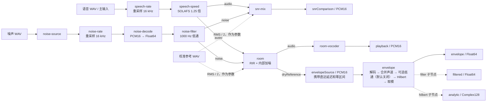

# 音频处理模块原理与流程

说明通用音频图的执行机制、DSP 数值处理、时间关系及参考验证。调用代码和参数用法集中在音频复用指南。

核对日期：2026-10-20，以当前工作区实现为准。

相关文档：[音频处理模块复用指南](音频处理模块复用指南.md) · [言语训练模块复用指南](言语训练模块复用指南.md) · [言语训练模块原理与流程](言语训练模块原理与流程.md)。

## 模块边界与图执行

Core 负责信号、图、路由与执行；Dsp 只接收显式数据和参数，负责数值处理；Sdl 负责系统输出。训练业务在 SpeechTraining 中把资源与设置变成图，不由 DSP 读取训练目录。各项目以不可变缓冲区作为边界，PCM、浮点、复数阶段不隐式互换。

`Build` 保存有序节点和命名出口。普通 `Then` 将当前引用接到 `audio` 输入；`Branch` 共享节点和出口集合，但持有独立游标。组合包络在建图时展开成普通节点，没有嵌套执行器。

执行器先依次调用节点的 `Describe`，检查引用是否已存在、端口和格式是否有效，再检查出口及对齐目标。因此图必须预先按拓扑顺序定义，不会自动排序。每次执行遍历全部节点，分支不并行，不裁剪未连接出口的节点，也不合并参数相同的节点。

主输入与各节点输出按 `AudioOutputRef` 存放。执行器统计后续消费次数，用完移除中间结果的引用，最终出口保持可访问。共享支路只是多次引用同一次节点输出，没有可变双路音频状态或跨会话缓存。

`IAudioExecutionMiddleware` 按注册顺序从外到内包裹节点，调用 `next()` 执行下层；DSP 本身不接收 next。记录包含节点身份、耗时与元数据。执行后检查端口完整性、类型、采样率、声道及时间域符合声明，检查时间信息合法性；数值能量等由 DSP 检查。异常类型不改写，只添加节点 ID 和处理器身份。

## 信号类型与时间关系

PCM16 缓冲区存小端交错字节；浮点与复数缓冲区存交错 double／Complex。PCM 构造复制数据，分析阶段在 double／Complex 间传递而不重复量化。PCM 内容哈希不含格式；图等价比较会另比较格式和选项。噪声的浮点内容哈希使用小端 IEEE754 double 字节，不先量化。

`AudioTimeline` 描述时间域、起点和零输出区间。变速节点把自身 ID 加入时间域；两个独立节点即使目标长度相同也不被视为同步。重采样保留秒级时间关系。执行器的 alignWith 只比较时间域，不判断样本峰值或推断非线性时轴。

RIR 的湿声沿用输入时间关系；`dryReference` 保留干净样本，将起点增加直达声延迟并声明传播前及尾部的零区间。执行器不会自动平移或清零音频，展示层负责解释。变速没有处理这些偏移的精确重映射，所以拒绝带非零起点或零区间的输入。

## 复杂 DAG 示例的路径

完整代码见[音频复用指南](音频处理模块复用指南.md#完整-dag-示例)。普通混音和 RIR 共享语音变速及浮点噪声支路；RIR 后的声码器用于播放，干净参考用于分析。校准文件是建图前的参数来源，不是信号节点。



## SOLAFS 与重采样

纯 C# `EGGtCSPlatform.Audio.Dsp.TimeStretch.Solafs` 采用研究项目 `SpeechIntelligibility/SOLA/solafs.m` 的同步重叠拼接思路，图中通过 `TimeStretchProcessor` 和 `TimeStretchOptions(TargetFrames)` 使用。以研究项目实际 16 kHz 输入为基准：窗口 200 点、重叠和相似度窗口 100 点、最大搜索偏移 400 点、相似度采样步长 8、搜索步长 2，其他采样率按时间换算。修正了上一输出位置的记录与连续位置预测，限制源窗口范围，并显式拼接末段，避免原循环留下未写入尾部。短音频缩小窗口，单帧延续样本值，静音保持零。内部双精度、输出 PCM16，不迁移旧脚本的 RMS 归一化；这是有边界修正的迁移，不承诺与原 MATLAB 输出逐样本相同。

通用 SOLAFS 只接收目标帧数；训练层负责把字/秒或自适应倍率换算成帧数。重采样用居中 Blackman 窗 sinc 插值和抗混叠低通，在实际输出采样时刻求值，不额外增加转换延迟。非空长度按采样率比例舍入，中点远离零且至少一帧；空输入保持空，采样率不变时直接复用输入。

## 普通噪声混音

PCM 噪声先经过 SincResampler 的 PCM16 编码边界，再解码；浮点噪声要求采样率已匹配，避免再量化。声道匹配时单声道复制、双声道到单声道取平均。以目标帧数截断或补零，再按 `(i + offset) % 目标帧数` 移位；不按文件自身长度重复。

普通混音的目标长度为语音长度。所有声道和全片段联合计算 RMS，语音增益为 `noiseRms / speechRms × 10^(SNR/20)`。相加后归一化至调用方的 calibrationRms，再按 PCM16 正峰上限进行整体衰减。训练提供的 calibrationRms 为完整 SSN-MSP RMS 的一半。不会逐样本削波；无能量或不可表示增益明确失败。SNR 表示声码器前混音条件，不保证后续非线性输出仍可分离出同样 SNR。

## 声码器

| 界面算法 | 研究训练入口对应分支 | 可调参数 |
| --- | --- | --- |
| 经典 CIS | `ClassicalVoc(..., strategy=1)` / `CIS_ClassicVocoder` | 频带数、噪声或纯音 |
| ACE | `ACEVoc(..., Strategy=1)` / `ACE_MyNewVocoder` | 频带数、噪声或纯音、最大激活通道数 |
| 经典 TLE | `ClassicalVoc(..., strategy=2)` / `TLE_ClassicVocoder` | 频带数、噪声或纯音 |
| ACE-TLE | `ACEVoc(..., Strategy=2)` / `TLE_MyNewVocoder` | 频带数、噪声或纯音、最大激活通道数 |

经典算法保留 80～7999 Hz Greenwood 划分、三阶原型的 Butterworth 带通、因果滤波、半波整流及 125 Hz 八阶包络低通；TLE 保留低频直通与频移分支及 50 Hz 参数。计算用双精度二阶节实现以避免低截止频率下高阶多项式抵消。噪声模式先生成共享高斯噪声，再逐频带滤波；纯音采用频带边界平均值作为频率。调制后求和并匹配输入 RMS，没有另加调制后带通。

ACE 类保留研究 128 点周期 Hann 窗、16 点步长（1000 Hz）、初始 112 点补零和末帧补零、固定 FFT 频带权重及功率均衡、25 dB 增益、最大通道选择、Q=20 压缩、THR=100/MCL=255、BaseLevel=0.0156/SaturationLevel=0.5859。ACE-TLE 使用其相位／频移结果调制，但按普通 ACE 能量选通道。电平与电极编号仅用于内部声学合成：保留 Gaussian 包络覆盖规则、纯音或随机多音载波、频带 RMS 匹配、去加重及最后输入 RMS 匹配，不产生电刺激指令。

声码器处理 16 kHz PCM16，双声道分别处理且共享相同随机载波序列。默认种子 1729 写入不可变处理配置，采用固定 LCG 与 Box–Muller 算法，不依赖运行时随机数版本；相同输入和配置可复现。播放音量不改变这些参数。

**边界修正。** 研究 `electrovocoder` 的 `sum(ModulatedBands)` 在单频带时会把时间维也加掉；迁移明确按频带求和，参考脚本作相同的形状修正。研究峰值缩放紧接着输入 RMS 匹配，两次整体缩放在非零输入上等价于一次 RMS 匹配；C# 保留其符号效果，避免零除。空输入返回空，静音和无有效能量的结果返回零，ACE 静音仍保持相同合成时长。PCM16 饱和转换不额外归一化，是否削波记入该步骤的 `AudioSnapshot.Execution` 中声码器节点的 `IntroducedClipping`。

声码器保持算法本身的因果滤波、分帧和合成响应，不移动已提取包络来匹配峰值。ACE 输出长度为 `round((序列长度 / (1000 × 最大激活数) + 0.06) × 16000)`。干净参考可以短于播放，末尾显示由消费者补零。

## 包络提取

组合处理器依次展开 PCM 解码、声道合并、可选 Butterworth 低通、Hilbert 解析变换、复数取模。解码为样本除以 32768；合并使用平均或选定声道。默认 `EnableFilter=false`，跳过低通，直接对声道合并后的信号做 Hilbert 变换。显式设置 `EnableFilter=true` 时，在 Hilbert 之前启用低通；其参数默认仍为 150 Hz、五阶，支持 1～12 阶，逐声道正反向处理。这不是提取包络之后的平滑滤波。奇对称延拓和端点稳态初值保持上述滤波参数的原系数、节顺序和浮点运算，填充长度 `min(3 × (order + 1), frames - 1)`，不足两帧不滤波。

Hilbert 使用精确输入 N 点长度，分别处理各声道，复数逐样本取模得到完整包络。所有节点保留帧数和时间信息；不会因零输出区间提前屏蔽样本。组合处理器先合并到单声道，而独立滤波、Hilbert、取模可处理双声道。空输入为空，静音为零，单样本包络为绝对值。

包络本身不做显示降采样或电流映射。训练显示和刺激预览处理见[言语训练模块原理与流程](言语训练模块原理与流程.md#显示与刺激预览)。

## RIR 生成与处理

### 独立生成器与数值约定

运行时采用独立托管实现的矩形房间镜像声源算法，声速 340 m/s、16 kHz、全向点声源与接收点。均匀墙面压力反射系数为 `sqrt(1 - 24 ln(10) V / (340 S T60))`；T60=0 表示无反射。非零 T60 对应吸声率必须在 (0,1] 内。每条路径按距离及墙面反射系数缩放，用 8 ms Hann-sinc 表示分数采样到达，并应用 100 Hz 高通。公开方法来源：Allen & Berkley (1979), DOI 10.1121/1.382599；Peterson (1986)；[AudioLabs 方法说明](https://www.audiolabs-erlangen.de/fau/professor/habets/resources/simulation)。运行时不包含或调用研究 GPL 生成器源码、MEX。

实际长度为 `max(T60, 请求长度)`；秒/毫秒转采样点均使用 `MidpointRounding.AwayFromZero`。完整 RIR 按最大正峰归一化，取首个最大正峰的零基索引 `d`；直达段为 `[0,d+10]`，早期段为 `[d+11,d+round(分界毫秒×16)]`（含端点），之后为晚期。早期关闭时该段置零，晚期关闭时截去晚期段；不重新归一化。响应不够容纳分界时明确报错。每个响应最多 160000 帧、2000 万个候选镜像；超预算拒绝，不降低反射阶数或截短响应。生成支持取消，调用方可缓存不可变响应；哈希为小端 IEEE754 double 序列的 SHA256，并记录算法版本 `image-source-1`。

### 校准、加噪声与包络

调用方先确保语音为 16 kHz，处理器再逐通道执行完整 FFT 线性卷积，双声道共用一个 RIR。公式为 `wet = conv(clean, effectiveRir) × calibrationRms / rms(fullRir[0..division])`；分母始终使用完整直达及早期系数，不随反射开关变化。`calibrationRms` 由调用方提供，**最终混响语音的 RMS 不一定等于此值**。

启用加噪时，能量参考为已校准的“直达声＋当前启用的早期反射”卷积，补零到最终输出长度。噪声匹配采样率、声道和目标长度后，使用调用方提供的偏移循环移位；`noiseGain = rms(earlySpeech) / rms(noise) / 10^(SNR/20)`，两者使用同一完整时间区间。只调整噪声增益，不改变研究校准的语音幅度，不做额外混音归一化。非有限增益、零能量或无法计算的极端 SNR 明确失败。

卷积和混音在浮点域完成，PCM16 编码前对整体等比例衰减防止削波。ReverbMetadata 记录响应、校准增益、噪声增益、峰值保护增益、早期参考语音 RMS、输出长度和实际入端噪声身份。干净参考仍为原始输入样本，仅用时间信息表达 `d/16000` 的偏移和尾部区间。它不同于内部用于能量标定的早期卷积参考。后续是否接声码器、如何显示由调用方决定。

## 数值参考与验证

### MATLAB 声码器参考数据

`scripts/GenerateSpeechVocoderReference.m` 仅用于开发时数值验收，需要 MATLAB 和 Signal Processing Toolbox。脚本从研究目录复制指定纯计算函数到临时目录，排除绘图，注入固定随机序列；不会运行训练入口、播放或串口代码，也不修改研究文件。临时目录在退出时清理。

在仓库根目录运行（按本机位置修改 MATLAB 与研究路径）：

```powershell
& D:/software/matlab2024a/bin/matlab.exe -batch "addpath('scripts'); GenerateSpeechVocoderReference('D:/desktop/research', fullfile(pwd,'EGGtCSPlatform.Audio.Dsp.Tests','Fixtures','SpeechVocoderReference.json'))"
dotnet test EGGtCSPlatform.Audio.Dsp.Tests --filter FullyQualifiedName~VocoderResearchTests
dotnet test EGGtCSPlatform.SpeechTraining.Tests --filter FullyQualifiedName~SpeechVocoderTests
```

固定 JSON 包含调幅信号和仓库 MHINT-P 实际语音片段，覆盖四算法、两载波、1/8/22 频带、不同激活数及奇偶长度；保存输入、随机序列、浮点输出，以及 ACE 权重、电极、电平和压缩参数。测试检查长度和离散结果一致，浮点最大绝对误差 ≤ `1e-4`、RMS 误差 ≤ `1e-5`。CI 使用已提交的 JSON，不要求安装 MATLAB。已有 Python 脚本仍只负责语音包络与刺激幅值参考，不承担声码器运行。

### Python 参考数据生成工具

[`scripts/GenerateSpeechEnvelopeReference.py`](../scripts/GenerateSpeechEnvelopeReference.py) 用于重新生成算法测试的固定参考数据。它通过 AST 仅加载研究项目 `ElectricalStimulationProject_0/Prepare_and_send_electrical_stimulation.py` 中的 `lowpass_filter`、`extract_envelope_hilbert`、`map_to_tacs` 和 `process_wave_data` 四个函数，不执行该模块的串口导入、设备控制或播放入口。

应用中的包络和刺激预览均使用纯 C#；应用运行和日常 .NET 测试不需要 Python、NumPy、SciPy 或研究目录。只有重新生成参考数据时需要这些依赖。在仓库根目录运行（已验证 Python 3.11，依赖版本如下）：

```powershell
python -m venv TestArtifacts/reference-python
& ./TestArtifacts/reference-python/Scripts/python.exe -m pip install numpy==2.4.6 scipy==1.17.1
& ./TestArtifacts/reference-python/Scripts/python.exe scripts/GenerateSpeechEnvelopeReference.py D:/desktop/research
```

最后一个参数为研究项目根目录，可替换为实际位置。脚本还读取当前仓库的 `MHINT-P/9.wav` 语音片段，与奇偶长度的确定性调幅信号组成三组样例，覆盖滤波、Hilbert 包络和两次映射后的刺激幅值。

输出并覆盖 [`EGGtCSPlatform.SpeechTraining.Tests/Fixtures/SpeechEnvelopeReference.json`](../EGGtCSPlatform.SpeechTraining.Tests/Fixtures/SpeechEnvelopeReference.json)，记录输入 PCM、各阶段参考结果、依赖版本及来源哈希。重新生成后检查差异，并运行下列数值对照；不要用重新生成基线掩盖算法偏差：

```powershell
dotnet test EGGtCSPlatform.SpeechTraining.Tests --filter "FullyQualifiedName~SpeechEnvelopeTests|FullyQualifiedName~SpeechStimulusTests"
dotnet test EGGtCSPlatform.Audio.Dsp.Tests --filter FullyQualifiedName~EnvelopeResearchTests
```

DSP 测试使用其 `Fixtures/SpeechEnvelopeReference.json` 独立副本；上述生成脚本当前
只更新训练测试的文件，不会同步另一份。可调截止频率、阶数等参数的参考夹具
`Audio.Dsp.Tests/Fixtures/EnvelopeParametersReference.json` 由
`scripts/GenerateEnvelopeParametersReference.py` 单独生成。

### RIR 参考

`EGGtCSPlatform.Audio.Dsp.Tests/Fixtures/SpeechRirReference.json` 由原研究生成器离线产生，包含默认条件、不同 T60/位置、分数延迟和无反射条件的完整响应与卷积。独立实现与基线最大绝对误差要求 <1e-8；另验证物理到达时刻、互易性、已知短卷积、反射开关、校准、SNR、峰值保护、声码器和会话状态。数值参考测试入口为 `Audio.Dsp.Tests` 的 `RirResearchTests`；训练集成测试仍位于 `SpeechTraining.Tests`。

MATLAB 有可用 C++ 编译器时运行 `GenerateSpeechRirReference(researchRoot, outputPath)`。旧 MEX 无法加载且 MATLAB 不支持已安装编译器时，可先用 `scripts/Build-SpeechRirReferenceOracle.ps1 -ResearchRoot ... -MatlabRoot ... -OutputDirectory artifacts/RirOracle`，再将此目录作为该 MATLAB 函数第三参数。此备用脚本仅在 artifacts 目录将原源码的 new/delete 分配语法改成 C 的 malloc/free，保留版权和全部数学计算，使用 MATLAB 自带 LCC 编译；该 GPL 派生测试产物不进入运行时、源码提交或发布包。

### 迁移基线与参数参考

`SpeechTraining.Tests/Fixtures/GenericApiBaseline.json` 保存迁移前 64 个组合的逐字段
SHA256，包括播放／参考 PCM、全量包络、显示、刺激预览、对齐及业务数值。
该文件由迁移前冻结程序集捕获，不从新实现生成。字段按名称排序，数组顺序、
数值精度和 PCM 字节保持原样。旧记录形状中的步骤来源列表不再参与新模型比较。
MATLAB 声码器及 SciPy 滤波/Hilbert、研究 RIR 参考测试位于 Audio.Dsp.Tests，
仅使用内存音频和夹具，保留原容差。SpeechTraining.Tests 另保留
`SpeechEnvelopeReference.json`，验证包络之后的刺激预览。
`GenerateSpeechEnvelopeReference.py` 当前只写训练测试中的这一份文件，
不会自动更新 DSP 测试目录中的同名夹具。

可调参数参考夹具 `EnvelopeParametersReference.json` 由 `scripts/GenerateEnvelopeParametersReference.py`
使用独立 SciPy butter/sosfiltfilt/hilbert 生成，覆盖 1–12 阶和奇偶、短长度；不会重写旧基线。

双输入迁移前的 `Audio.Dsp.Tests/Fixtures/NoiseInputBaseline.json` 保存额外 64 个普通／RIR
噪声长度、采样率、声道与偏移组合，比较匹配 double 字节、混音 PCM 和数值元数据；
来源与程序集哈希见同目录 `NoiseInputBaseline.md`，不从新实现重新生成。
