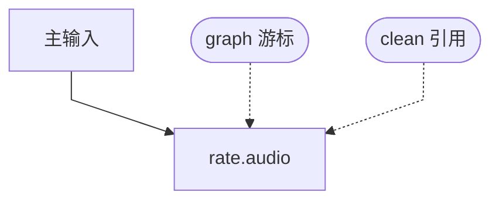
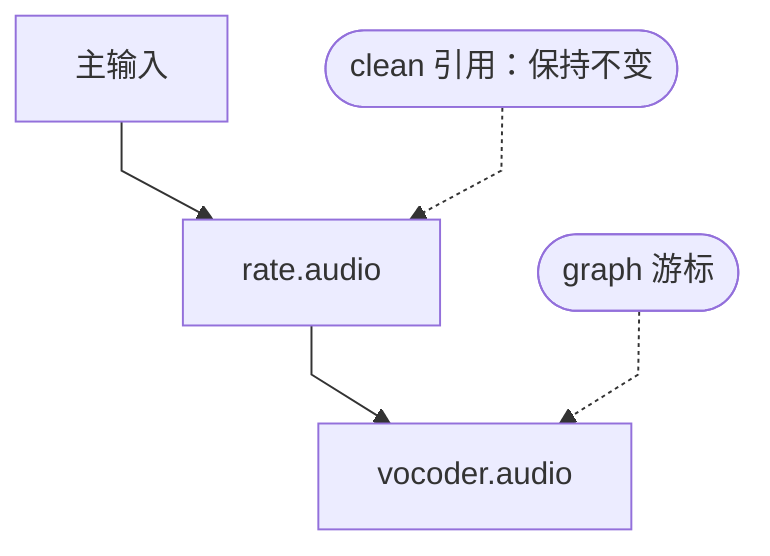
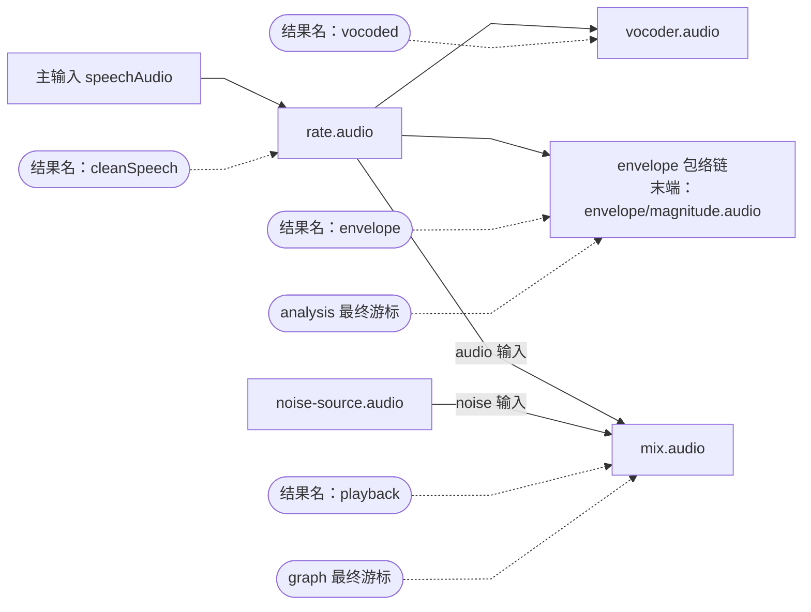
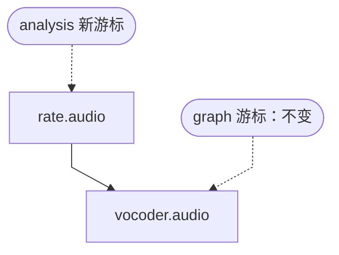
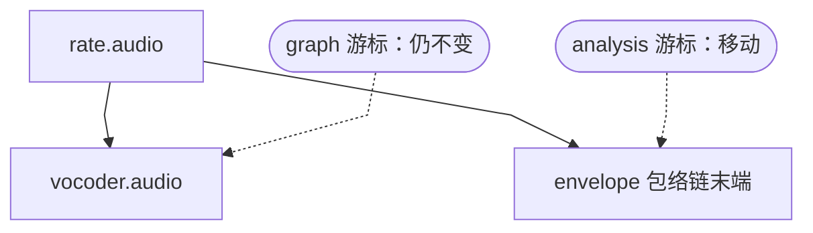
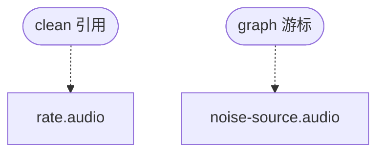
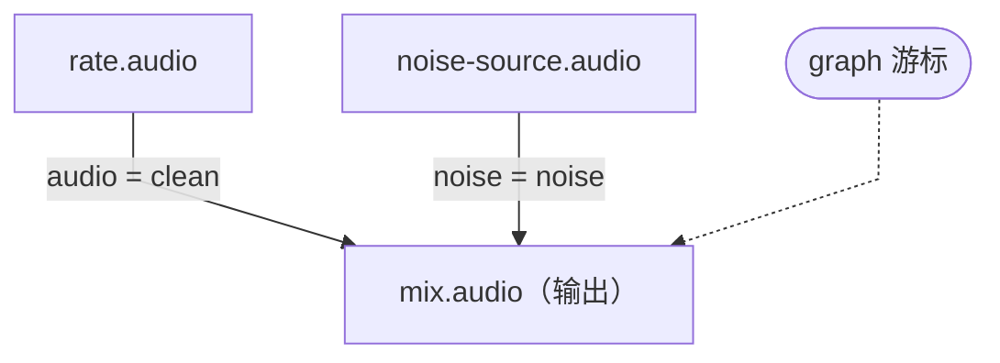
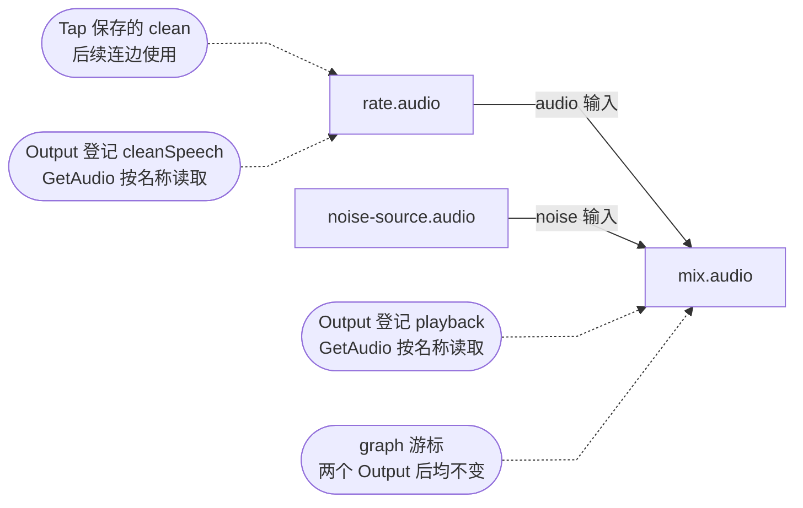

# 音频处理模块复用指南

面向独立复用音频处理的调用方：介绍项目引用、公开 API、完整示例和使用限制。

核对日期：2026-10-20，以当前工作区实现为准。

相关文档：[言语训练模块复用指南](言语训练模块复用指南.md) · [音频处理模块原理与流程](音频处理模块原理与流程.md) · [言语训练模块原理与流程](言语训练模块原理与流程.md)。

## 依赖与快速开始

| 引用项目 | 可以复用的功能 |
| --- | --- |
| `EGGtCSPlatform.Audio.Core` | PCM16／Float64／Complex128 缓冲区、图 API、执行器、时间信息、`IAudioPlayer` |
| `EGGtCSPlatform.Audio.Dsp` | WAV 读取和全部内置处理器；传递引用 Core |
| `EGGtCSPlatform.Audio.Sdl` | 默认音频设备播放器；引用 Core 和 SDL3-CS／原生包 |

均使用 .NET 10。仅处理音频引用 Dsp 即可；需要实际播放再引用 Sdl。无需引用训练模块、Avalonia、设备 SDK 或复制训练资源。Core 没有第三方包。

从仓库根目录先运行已有示例，无需音频设备：

```powershell
dotnet run --project EGGtCSPlatform.Audio.Sample -- clean
dotnet run --project EGGtCSPlatform.Audio.Sample -- vocoded
dotnet run --project EGGtCSPlatform.Audio.Sample -- mix
dotnet run --project EGGtCSPlatform.Audio.Sample -- clean --manual
dotnet run --project EGGtCSPlatform.Audio.Sample -- clean --filter-noise
```

`clean` 取干净参考，`vocoded` 取干净语音独立声码器支路，`mix` 取加噪后经过声码器的实际播放支路；三者改变包络来源。`--manual` 改用手动包络节点链，`--filter-noise` 启用噪声预处理。可在模式后增加一个 PCM16 WAV 路径。

## 核心 API

| API | 用法与契约 |
| --- | --- |
| `AudioBuffer(sampleRate, channels, bytes)` | 只读小端 PCM16；构造时复制输入。`Data` 是只读 Span，`ToArray()` 返回副本 |
| `FloatBuffer`／`ComplexBuffer` | 分别保存 double／Complex，使用交错声道布局；类型在端口之间必须匹配 |
| `AudioSignal`／`FloatSignal`／`ComplexSignal` | 缓冲区及 `Timeline`；用 `GetAudio/GetFloat/GetComplex` 读取 |
| `AudioPipelineBuilder` | 使用下表操作定义节点与命名出口 |
| `AudioNodeDefinition<TOptions>` | 通过输入端口字典显式连接一个或多个上游 |
| `AudioOutputRef(nodeId, port = "audio")` | 引用节点端口；`AudioOutputRef.Source` 为执行时传入的主输入 |
| `AudioPipelineExecutor.Validate` | 检查给定图和输入的格式契约，返回按输出引用索引的格式表 |
| `AudioPipelineExecutor.ExecuteAsync` | 接受图、主输入和取消令牌，返回 `AudioPipelineResult`；不会自动切到后台线程 |
| `AudioPipelineResult` | `Outputs` 为命名信号，`Records` 为执行记录；按类型使用三个 `Get…` 方法 |
| `AudioPipelineDefinition.EquivalentTo` | 比较有序节点、处理器身份、参数、输入连接及出口；主输入另行比较 |
| `IAudioProcessor<TOptions>`／`SingleInputAudioProcessor<TOptions>` | 自定义节点的接口／单输入基类，定义格式描述、版本化身份与执行方法；通过 Then 或 Add 注册 |
| `IAudioCompositeProcessor<TOptions>` | 定义组合节点，通过 Then 使用；只能声明所属 ID 前缀下的子节点，不声明最终出口 |
| `IAudioExecutionMiddleware` | 通过执行器构造参数注入，使用 `InvokeAsync(node, next, token)` 包裹节点调用 |

缓冲区均支持 8–192 kHz、单／双声道；`Frames` 是帧数，不是字节数或跨声道样本数。主输入可以是 PCM16、浮点或复数缓冲区，也可传入携带时间信息的信号。节点选项应为不可变值；自定义集合参数需要值相等语义。

### 建图方法

建图时要区分三个对象：**节点**是处理器，**边**连接上游输出端口与下游输入端口，**游标**是某个 builder 记住的输出端口，表示下一次 `Then` 默认从哪里继续接。游标不是处理节点，也不是播放进度；每个 builder 有自己的游标。

本节图中的**实线箭头表示音频数据连接，虚线箭头表示游标、保存的引用或结果名称指向某个端口**。圆角标记只是帮助阅读，不是图中新增的处理器。图示围绕 API 调用效果，不涉及执行器内部流程。

| 操作 | 对节点和边的操作 | 调用后的游标 |
| --- | --- | --- |
| `Then(id, processor, options)` | 添加处理节点，自动将当前引用连到其 `audio` 输入 | 移到新节点输出；组合处理器移到展开链末端 |
| `Add(node)` | 添加节点，按输入字典显式连边 | 移到新节点默认 `audio` 输出，不取决于字典里最后一项 |
| `Source(id, buffer)` | 添加没有输入边的额外 PCM16 源节点 | 移到源节点 `audio` 输出 |
| `Tap(port = "audio")` | 不加节点、不连边，只取得当前节点指定端口的引用 | 不变 |
| `Branch(reference)` | 不加节点、不连边，返回共享同一图的新 builder | 新 builder 指向 reference；原 builder 不变 |
| `Output(name, source = null, alignWith = null, intentionalMismatch = false)` | 给选定输出登记一个结果名称，不添加处理节点或数据边 | 不变，即使显式指定了另一个 source |
| `Build()` | 生成当前图定义的快照，不执行音频处理 | 不变 |

按依赖顺序添加节点，ID 和出口名各自唯一；不能形成环或引用尚未添加的节点。不要在 `Source` 移动游标后误把噪声当作语音继续处理，提前保存引用再分支。多输入处理器使用 `Add`，而不是单输入 `Then`。

#### Then 与 Tap：继续连接，以及记住连接位置

新 builder 的初始游标是 `AudioOutputRef.Source`，即将来执行时传入的主输入。普通 `Then` 完成“添加节点＋自动连接”；`Tap` 保存的是一个 `AudioOutputRef`，包含节点 ID 和输出端口名，不复制音频、不执行计算。

以下是可连续使用的建图片段，项目引用同本文完整 DAG 示例。假定 `speechAudio`、`noiseAudio` 为已加载的非空 PCM16 缓冲区，`calibrationRms` 为有效的正有限校准值；语音和匹配后的噪声须有能量。

<!-- audio-builder:cursor-example -->
```csharp
using EGGtCSPlatform.Audio.Core.Execution;
using EGGtCSPlatform.Audio.Core.Pipeline;
using EGGtCSPlatform.Audio.Core.Routing;
using EGGtCSPlatform.Audio.Dsp.Envelope;
using EGGtCSPlatform.Audio.Dsp.Noise;
using EGGtCSPlatform.Audio.Dsp.Resampling;
using EGGtCSPlatform.Audio.Dsp.Vocoder;

var graph = new AudioPipelineBuilder(); // graph 游标：主输入
graph.Then("rate", new ResampleProcessor(), new ResampleOptions(16000));
var clean = graph.Tap();                // clean = rate.audio；graph 仍在 rate.audio
graph.Then("vocoder", new VocoderProcessor(), new VocoderOptions());
graph.Output("vocoded");                // graph 仍在 vocoder.audio

var analysis = graph.Branch(clean);     // analysis 在 rate.audio；graph 不变
analysis.Then("envelope", new EnvelopeProcessor(), new EnvelopeOptions());
analysis.Output("envelope");            // analysis 在 envelope/magnitude.audio

var noise = graph.Source("noise-source", noiseAudio).Tap();
// graph 现在在 noise-source.audio；clean 和 analysis 都不变
graph.Add(new AudioNodeDefinition<NoiseMixOptions>(
    "mix", new NoiseMixProcessor(),
    new NoiseMixOptions(OffsetFrames: 0, SnrDb: 5, CalibrationRms: calibrationRms),
    new Dictionary<string, AudioOutputRef>
    {
        ["audio"] = clean,              // rate.audio → mix 的 audio 输入
        ["noise"] = noise               // noise-source.audio → mix 的 noise 输入
    }));
// graph 现在在 mix.audio
graph.Output("playback");               // playback 指向 mix.audio；游标不变
graph.Output("cleanSpeech", clean);     // cleanSpeech 指向 rate.audio；游标仍不变

var pipeline = graph.Build();
var executor = new AudioPipelineExecutor();
executor.Validate(pipeline, speechAudio);
var result = await executor.ExecuteAsync(pipeline, speechAudio);
var playback = result.GetAudio("playback");
var cleanSpeech = result.GetAudio("cleanSpeech");
var envelope = result.GetFloat("envelope");
```

`clean` 在后续操作中一直指向 `rate.audio`，不会跟随 `graph` 的游标移动。上例最终提供四个结果：`vocoded` 是干净语音的声码器输出，`envelope` 是干净包络，`playback` 是普通加噪输出，`cleanSpeech` 是重采样后的干净语音。它们的名称由调用方选择，不会改变处理行为。

先看 `Tap` 前后，以及随后调用 `Then` 的区别。两幅图中的 rate 是同一个节点在不同调用时刻的状态：

**① 添加 rate，再执行 clean = graph.Tap()**



**② graph.Then 添加 vocoder**



完整片段建成后的连接如下。为便于阅读，将组合包络展开的子节点折叠为一个框，实际末端为 `envelope/magnitude.audio`：



#### Branch：同一张图，不同的继续连接位置

上例 `graph.Branch(clean)` 返回 `analysis`，两个 builder **共享节点列表和出口列表，只有游标独立**。`Branch` 本身没有添加“分叉节点”；之后添加的消费者引用同一个上游输出时，才形成分支。

**① analysis = graph.Branch(clean)**



**② analysis.Then 添加包络**



第①步只多了一个游标标记；第②步才多出包络处理路径。两条路径共用 rate，没有第二份 rate。

| 完成操作后 | graph 的游标 | analysis 的游标 |
| --- | --- | --- |
| 添加 rate 并 Tap | `rate.audio` | 尚未创建 |
| 添加 vocoder 并声明 vocoded | `vocoder.audio` | 尚未创建 |
| `analysis = graph.Branch(clean)` | `vocoder.audio` | `rate.audio` |
| analysis 添加组合包络并声明出口 | `vocoder.audio` | `envelope/magnitude.audio` |
| graph 添加 noise-source | `noise-source.audio` | `envelope/magnitude.audio` |
| graph 添加 mix | `mix.audio` | `envelope/magnitude.audio` |
| graph 声明 playback、cleanSpeech | `mix.audio` | `envelope/magnitude.audio` |

因此，不能通过 `graph.Branch(clean); graph.Then(...)` 将原游标移回 clean：必须保存返回的 builder，或直接使用 `graph.Branch(clean).Then(...)`。同样，`var other = graph` 只是给同一个 builder 取别名，两者操作同一个游标，不等同于 `Branch`。

从 `graph.Build()` 或 `analysis.Build()` 都能取得两边共同添加的节点和出口。分支不复制上游数据，也不代表并行执行；共享的 rate 节点每次执行只处理一次。

#### Add：显式连边，处理多输入汇合

`Then` 只自动连接一个名为 `audio` 的输入；`Add` 接受完整节点定义，字典的**键是新节点输入端口名，值是上游输出引用**。上例两条连接分别为 `rate.audio → mix.audio（输入）`、`noise-source.audio → mix.noise（输入）`。

`Add` 不会把当前游标额外接进去，也不会推断缺失端口。虽然调用时 graph 的游标在噪声源，它仍按字典将 clean 接到语音端口。两路数据怎样混合由 `NoiseMixProcessor` 决定；Add 只声明连接。它也支持单输入或零输入节点，不是只能做汇合。

调用后游标指向 `mix.audio（输出）`。随后直接 `Then` 会处理混音；要继续处理干净语音，应从 clean 创建分支。

**① Source 后，Add 前**



**② Add 按输入字典添加 mix**



这里语音边来自字典中的 clean，而非调用前的 graph 游标。`Source` 添加噪声源时没有生成 `rate → noise-source` 连接；`Add` 才按字典将两路接入 mix。

#### Tap 与 Output：端口引用和结果名称是两回事

`Tap` 返回供后续连接使用的端口引用；`Output` 把端口登记到执行结果中，便于按名称读取。`Output` 返回 builder 以便继续链式调用，不返回 `AudioOutputRef`。声明出口不会终止路径，后面仍可以继续 `Then`。

- `graph.Output("playback")`：登记当前游标。
- `graph.Output("cleanSpeech", clean)`：登记指定引用，**不把游标移到 clean**。
- 同一端口可登记多个不同结果名称；节点之间连接应使用端口引用，不能把结果名称当作节点 ID。
- `alignWith: "playback"` 是时间域约束，不是额外数据边，也不自动移动或补齐样本。

以下为连续片段最后两个 `Output` 调用后的状态。实线数据连接保持原样；新增的是结果名称映射：



对照这张图：`Tap` 取得引用，`Branch` 用引用设置另一个 builder 的游标，`Add` 用引用建立实际输入边，`Output` 用引用登记结果名称。只有添加消费者节点并连接输入，才会增加实际的数据处理路径。

多输出处理器应明确选端口。例如下面片段假定 `roomBuilder` 的当前节点是已添加的 `ReverbProcessor`：

```csharp
var wet = roomBuilder.Tap();               // 当前 RIR 节点的 audio
var dry = roomBuilder.Tap("dryReference");  // 同一节点的 dryReference，游标不变
roomBuilder.Output("dry", dry);            // 登记 dry，不改变 roomBuilder 游标
```

一个容易忽略的细节：`Tap()` 默认取的是**当前节点的 audio 端口**。如果用 `Branch(dry)` 创建游标，该游标确实指向 dryReference，后续 `Then` 会使用它；但此时再调用无参数 `Tap()`，取得的会是同一节点的 audio。要保留干净端口，继续使用 dry 或显式调用 `Tap("dryReference")`。

#### Source 与 Build：添加输入，以及取得定义快照

主输入由 `ExecuteAsync(pipeline, speechAudio)` 提供，不需要再次调用 `Source`。`Source("noise-source", noiseAudio)` 添加的是另一份独立输入，不读文件、不自动接到主输入；它会移动调用者的游标。

`Build()` 只生成定义快照，既不执行，也不替代 `Validate`。之后继续添加节点不会自动修改已有 pipeline，需要再次 Build。前向引用、环或格式不匹配由执行前校验拒绝；`ExecuteAsync` 内部也会进行校验。

## 完整 DAG 示例

下面的控制台程序输入语音、噪声、校准参考三个 PCM16 WAV 路径，提供普通加噪对照、RIR 后声码器播放数据、干净参考、完整包络及两个中间出口。它只计算并打印结果，不播放、不发送刺激、不写音频文件。

图示及路径解释见[音频处理模块原理与流程](音频处理模块原理与流程.md#复杂-dag-示例的路径)。本例直接调用通用音频 API，不可作为任意图注入要求内置预设的 `SpeechTrainingSession`。

### 创建项目和完整代码

在仓库根目录运行下面的 PowerShell 命令。`artifacts` 已被 Git 忽略；首次使用该目录时创建项目，已有项目则跳过创建命令。

```powershell
dotnet new console --framework net10.0 --output artifacts/AudioDagGuide
dotnet add artifacts/AudioDagGuide/AudioDagGuide.csproj reference EGGtCSPlatform.Audio.Dsp/EGGtCSPlatform.Audio.Dsp.csproj
```

将生成的 `Program.cs` **完整替换**为以下代码。默认启用隐式 using；显式列出的 using 已覆盖这里使用的音频 API。

<!-- audio-dag-guide:program -->
```csharp
using System.Runtime.InteropServices;
using System.Security.Cryptography;
using EGGtCSPlatform.Audio.Core.Buffers;
using EGGtCSPlatform.Audio.Core.Execution;
using EGGtCSPlatform.Audio.Core.Pipeline;
using EGGtCSPlatform.Audio.Core.Routing;
using EGGtCSPlatform.Audio.Dsp.Conversion;
using EGGtCSPlatform.Audio.Dsp.Envelope;
using EGGtCSPlatform.Audio.Dsp.Filtering;
using EGGtCSPlatform.Audio.Dsp.IO;
using EGGtCSPlatform.Audio.Dsp.Noise;
using EGGtCSPlatform.Audio.Dsp.Resampling;
using EGGtCSPlatform.Audio.Dsp.Reverb;
using EGGtCSPlatform.Audio.Dsp.TimeStretch;
using EGGtCSPlatform.Audio.Dsp.Transforms;
using EGGtCSPlatform.Audio.Dsp.Vocoder;

if (args.Length != 3)
    throw new ArgumentException(
        "Usage: AudioDagGuide <speech.wav> <noise.wav> <calibration.wav>");

using var cancellation = new CancellationTokenSource();
ConsoleCancelEventHandler cancelHandler = (_, e) =>
{
    e.Cancel = true;
    cancellation.Cancel();
};
Console.CancelKeyPress += cancelHandler;

try
{
    var token = cancellation.Token;
    token.ThrowIfCancellationRequested();
    AudioBuffer speech = Pcm16WaveReader.Read(args[0]);
    AudioBuffer noiseAudio = Pcm16WaveReader.Read(args[1]);
    AudioBuffer calibration = Pcm16WaveReader.Read(args[2]);
    if (speech.Frames == 0 || noiseAudio.Frames == 0 || calibration.Frames == 0)
        throw new InvalidDataException("三个输入文件都必须包含样本。");
    double calibrationRms = NoiseMixer.Rms(Pcm16Codec.Decode(calibration)) / 2;
    if (!double.IsFinite(calibrationRms) || calibrationRms <= 0)
        throw new InvalidDataException("校准参考必须具有有效能量。");
    token.ThrowIfCancellationRequested();

    const int sampleRate = 16000;
    const double speedMultiplier = 1.25;
    const double snrDb = 5;
    // 与 ResampleProcessor 的帧数舍入规则一致；变速目标基于重采样后的帧数。
    int resampledFrames = Math.Max(1, checked((int)Math.Round(
        speech.Frames * (double)sampleRate / speech.SampleRate,
        MidpointRounding.AwayFromZero)));
    int targetFrames = checked((int)Math.Round(
        resampledFrames / speedMultiplier, MidpointRounding.AwayFromZero));
    if (targetFrames < 1)
        throw new ArgumentException("变速后的目标长度不足一帧。");

    var graph = new AudioPipelineBuilder();
    var clean = graph
        .Then("speech-rate", new ResampleProcessor(), new ResampleOptions(sampleRate))
        .Then("speech-speed", new TimeStretchProcessor(), new TimeStretchOptions(targetFrames))
        .Tap();

    // Source 会移动当前游标；提前保存 clean，后面通过 Add 显式连接语音。
    var noise = graph
        .Source("noise-source", noiseAudio)
        .Then("noise-rate", new ResampleProcessor(), new ResampleOptions(sampleRate))
        .Then("noise-decode", new PcmDecodeProcessor(), new PcmDecodeOptions())
        .Then("noise-filter", new ButterworthFilterProcessor(),
            new ButterworthFilterOptions(CutoffHz: 1000, Order: 4))
        .Tap();

    // 偏移以最终匹配长度为范围；本例使用固定值，便于复现。
    int mixOffset = 317 % targetFrames;
    graph.Add(new AudioNodeDefinition<NoiseMixOptions>(
        "snr-mix", new NoiseMixProcessor(),
        new NoiseMixOptions(mixOffset, snrDb, calibrationRms),
        new Dictionary<string, AudioOutputRef>
        {
            ["audio"] = clean,
            ["noise"] = noise
        }))
        .Output("snrComparison");

    var roomSettings = new RirSettings(
        Room: new RoomPoint(5, 4, 6),
        Source: new RoomPoint(2, 3.5, 2),
        Listener: new RoomPoint(2, 1.5, 2),
        T60: 0.3, LengthSeconds: 0.3,
        EarlyLateMilliseconds: 50, Early: true, Late: true);
    var response = new RirGenerator().Generate(roomSettings, token);
    int roomFrames = checked(targetFrames + response.Effective.Length - 1);
    int roomOffset = 317 % roomFrames;
    graph.Add(new AudioNodeDefinition<ReverbOptions>(
        "room", new ReverbProcessor(),
        new ReverbOptions(roomSettings, calibrationRms,
            new ReverbNoiseOptions(roomOffset, snrDb), PreparedResponse: response),
        new Dictionary<string, AudioOutputRef>
        {
            ["audio"] = clean,
            ["noise"] = noise
        }));
    var wet = graph.Tap();
    var dry = graph.Tap("dryReference");

    graph.Branch(wet)
        .Then("room-vocoder", new VocoderProcessor(),
            new VocoderOptions(
                Algorithm: VocoderAlgorithm.ClassicalCis,
                Bands: 8, Carrier: VocoderCarrier.Noise, Maxima: 8, Seed: 1729))
        .Output("playback");
    graph.Output("envelopeSource", dry, alignWith: "playback");

    // 为演示 filtered 中间出口，此例显式开启低通；EnvelopeOptions 默认关闭低通。
    var envelopeOptions = new EnvelopeOptions(
        CutoffHz: 150, FilterOrder: 5, EnableFilter: true,
        ChannelMode: ChannelMixMode.Average, ChannelIndex: 0);
    // BEGIN ENVELOPE CHAIN
    graph.Branch(dry)
        .Then("envelope", new EnvelopeProcessor(), envelopeOptions)
        .Output("envelope", alignWith: "playback");
    // END ENVELOPE CHAIN
    graph.Output("filtered", new AudioOutputRef("envelope/filter"), alignWith: "playback");
    graph.Output("analytic", new AudioOutputRef("envelope/hilbert"), alignWith: "playback");

    var pipeline = graph.Build();
    var executor = new AudioPipelineExecutor();
    // Validate 只检查描述信息，不运行 DSP；ExecuteAsync 内部也会先校验。
    var formats = executor.Validate(pipeline, speech);
    foreach (var (name, route) in pipeline.Outputs.OrderBy(p => p.Key))
    {
        var format = formats[route.Source];
        Console.WriteLine(
            $"Output {name}: {format.SampleType}, {format.SampleRate} Hz, " +
            $"{format.Channels} ch, domain={format.TimeDomain}");
    }
    var result = await executor.ExecuteAsync(pipeline, speech, token);
    AudioBuffer playback = result.GetAudio("playback");
    AudioBuffer comparison = result.GetAudio("snrComparison");
    FloatBuffer envelope = result.GetFloat("envelope");
    FloatBuffer filtered = result.GetFloat("filtered");
    ComplexBuffer analytic = result.GetComplex("analytic");
    var reference = result.Outputs["envelopeSource"];
    Console.WriteLine($"Playback: {playback.Frames} frames, SHA256={playback.ContentHash}");
    Console.WriteLine($"Comparison: {comparison.Frames} frames, SHA256={comparison.ContentHash}");
    Console.WriteLine($"Reference: {reference.GetAudio().Frames} frames, " +
        $"SHA256={reference.GetAudio().ContentHash}");
    Console.WriteLine($"Reference start: {reference.Timeline.StartSeconds:F6} s");
    foreach (var region in reference.Timeline.Regions)
        Console.WriteLine($"Zero region: [{region.StartSeconds:F6}, {region.EndSeconds:F6}) s");
    Console.WriteLine($"Envelope: {envelope.Frames} frames, SHA256=" +
        Convert.ToHexString(SHA256.HashData(MemoryMarshal.AsBytes(envelope.Data))));
    Console.WriteLine($"Filtered: {filtered.Frames} frames, SHA256=" +
        Convert.ToHexString(SHA256.HashData(MemoryMarshal.AsBytes(filtered.Data))));
    Console.WriteLine($"Analytic: {analytic.Frames} frames, SHA256=" +
        Convert.ToHexString(SHA256.HashData(MemoryMarshal.AsBytes(analytic.Data))));
    foreach (var record in result.Records)
        Console.WriteLine($"Node {record.NodeId}: {record.ProcessorIdentity}, " +
            $"{record.Elapsed.TotalMilliseconds:F3} ms, " +
            $"metadata={record.Metadata?.GetType().Name ?? "none"}");
    Console.WriteLine($"Executed {result.Records.Length} nodes, " +
        $"{result.Records.Select(r => r.NodeId).Distinct().Count()} distinct IDs.");
}
catch (OperationCanceledException)
{
    Console.Error.WriteLine("处理已取消。");
    Environment.ExitCode = 2;
}
catch (Exception error)
{
    Console.Error.WriteLine(error.Message);
    if (error.Data["Audio.NodeId"] is { } nodeId)
        Console.Error.WriteLine($"Node: {nodeId}; processor: {error.Data["Audio.Processor"]}");
    Environment.ExitCode = 1;
}
finally
{
    Console.CancelKeyPress -= cancelHandler;
}
```

输入文件不存在、格式非法、混音片段无能量、参数越界等错误会明确结束处理；不会自动替换资源。按 Ctrl+C 可取消支持令牌的计算，已开始的同步 WAV 读取不会被即时中断。执行器不自动创建后台线程；在 UI 中复用时，应像训练会话一样在后台完成文件读取和 DSP。

从仓库根目录使用现有资源运行：

```powershell
dotnet run --project artifacts/AudioDagGuide -- `
  EGGtCSPlatform.SpeechTraining/Resources/MHINT-P/9.wav `
  EGGtCSPlatform.SpeechTraining/NoiseResources/Babble-MHINT.wav `
  EGGtCSPlatform.SpeechTraining/NoiseResources/SSN-MSP.wav
```

本例提供六个出口，执行 14 个展开后的节点；`speech-speed`、`noise-source`、`noise-filter` 各出现一次。`playback`、`snrComparison`、`envelopeSource` 使用 `GetAudio`，`envelope`、`filtered` 使用 `GetFloat`，`analytic` 使用 `GetComplex`；类型不符会抛出异常。`Records` 保留每个节点的标识、耗时和元数据，可按节点 ID 找到 `NoiseMixMetadata`、`ReverbMetadata` 或 `VocoderMetadata`。

示例的浮点／复数 SHA256 使用本机内存字节，用于同一环境下比较两种建图方式；它不是跨平台文件协议。`AudioBuffer.ContentHash` 为 PCM 字节哈希，采样率和声道须另外检查。`Data` 为只读 Span，需要独立持有数组时使用 `ToArray()`。校准参考只是数值输入；示例的 5 dB、1.25 倍和房间参数是演示条件，不会改变训练默认设置。

### 将组合包络替换为手动节点链

保持上面程序的其余部分不变，将 `BEGIN ENVELOPE CHAIN` 与 `END ENVELOPE CHAIN` 之间的代码替换为下面片段。使用同一份 `envelopeOptions`、同一输入引用 `dry` 和相同子节点 ID，因此后面的 `filtered`、`analytic` 出口无需修改。

<!-- audio-dag-guide:manual-envelope -->
```csharp
var envelopeBranch = graph.Branch(dry)
    .Then("envelope/decode", new PcmDecodeProcessor(), new PcmDecodeOptions())
    .Then("envelope/channels", new ChannelMixProcessor(),
        new ChannelMixOptions(envelopeOptions.ChannelMode, envelopeOptions.ChannelIndex));
if (envelopeOptions.EnableFilter)
    envelopeBranch.Then("envelope/filter", new ButterworthFilterProcessor(),
        new ButterworthFilterOptions(envelopeOptions.CutoffHz, envelopeOptions.FilterOrder));
envelopeBranch
    .Then("envelope/hilbert", new HilbertTransformProcessor(), new HilbertTransformOptions())
    .Then("envelope/magnitude", new ComplexMagnitudeProcessor(), new ComplexMagnitudeOptions())
    .Output("envelope", alignWith: "playback");
```

在相同输入和参数下，两种写法的播放、参考、全量包络及两个中间出口应相同，执行节点列表也相同；耗时不要求相同。若关闭 `EnableFilter`，两种写法均不生成 `envelope/filter`，必须同时删除 `filtered` 出口声明及其读取、打印代码。组合节点本身不出现在执行记录中，也不存在可引用的独立 `"envelope"` 节点端口；它是建图时的展开操作。

## 内置处理器使用手册

以下 12 类均可在完整 DAG 示例中的项目引用下使用。命名空间中的 `Core.*`、`Dsp.*` 分别是 `EGGtCSPlatform.Audio.Core.*`、`EGGtCSPlatform.Audio.Dsp.*` 的缩写；实际 using 必须写全名。下列片段是**彼此独立**的局部示例，不应逐段粘贴到同一游标后面。

片段统一假定 `graph` 是一个新建 builder；`pcmRef`、`floatRef`、`complexRef` 是该图中已经定义、类型分别匹配的输出引用，`noiseRef` 是合法噪声引用；PCM 主输入可以直接使用 `AudioOutputRef.Source`。`noiseAudio` 为已读取的 `AudioBuffer`，`targetFrames` 为合法目标帧数，`offsetFrames` 为合法混音偏移，`calibrationRms` 为正有限校准值。各片段的命名输出只在片段自身使用；需要合并时应重新选择唯一 ID。

### 1. AudioBufferSourceProcessor：额外 PCM 源

命名空间 `Core.Pipeline`。无输入，输出 `audio: Pcm16`；参数为 `AudioBufferSourceOptions(AudioBuffer Buffer)`，必填、无默认缓冲区。`graph.Source` 是该节点的便捷写法：

```csharp
var noiseRef = graph.Source("noise-source", noiseAudio).Tap();
```

节点不读取文件或转换样本；先用 `Pcm16WaveReader.Read` 加载。`AudioBuffer` 构造时已复制输入字节，不会因外部数组变动改变内容。源节点时间域为 `resource:<节点ID>`，起点为零。其格式和内容身份参与图等价比较。

### 2. ResampleProcessor：PCM 重采样

命名空间 `Dsp.Resampling`。输入 `audio: Pcm16`，输出 `audio: Pcm16`；`ResampleOptions(int SampleRate)` 必填，无默认目标采样率，范围 8000～192000 Hz。

```csharp
graph.Branch(pcmRef)
    .Then("rate", new ResampleProcessor(), new ResampleOptions(16000))
    .Output("resampled");
```

保留声道与时间域，不增加显式时间偏移。浮点或复数输入不支持；RIR 和声码器前须自行确保 16 kHz。

### 3. TimeStretchProcessor：指定目标长度的 SOLAFS

命名空间 `Dsp.TimeStretch`。输入、输出均为 `audio: Pcm16`；参数 `TimeStretchOptions(int TargetFrames)` 必填。节点接收目标帧数，不直接接收“字/秒”或倍率。

```csharp
graph.Branch(pcmRef)
    .Then("speed", new TimeStretchProcessor(), new TimeStretchOptions(targetFrames))
    .Output("stretched");
```

目标必须为正且不超过 `int.MaxValue / (声道数 × 2)`；采样率、声道不变。需要按倍率调整时，由调用方计算目标帧数，完整示例给出了计算方法。输入不能已有非零起点或零输出区间；底层 SOLAFS 对空输入原样返回，不会生成目标长度的静音，因此本例和训练预设都提前拒绝空语音。新时间域包含该节点 ID；需同步的播放与分析应共用它的输出。

### 4. NoiseMixProcessor：双输入普通加噪

命名空间 `Dsp.Noise`。输入为 `audio: Pcm16` 和 `noise: Pcm16/Float64`，输出 `audio: Pcm16`。`NoiseMixOptions(int OffsetFrames, double SnrDb, double CalibrationRms)` 三项必填，没有资源参数。

```csharp
graph.Add(new AudioNodeDefinition<NoiseMixOptions>(
    "mix", new NoiseMixProcessor(), new NoiseMixOptions(offsetFrames, 5, calibrationRms),
    new Dictionary<string, AudioOutputRef>
    {
        ["audio"] = pcmRef,
        ["noise"] = noiseRef
    })).Output("mixed");
```

SNR 必须有限，允许负值，不设 20 dB 上限；校准 RMS 必须为正有限值。偏移范围为 `[0, 语音帧数)`。PCM 噪声内部会匹配采样率；浮点噪声必须预先匹配。噪声按目标长度截断／补零并循环移位，不按原文件长度重复；单／双声道按需复制或平均。噪声可有独立时间域，但不可有非零起点或零输出区间。

校准与峰值保护属于该处理器的输出行为，使用实际输出及元数据作为记录。空或无能量语音、匹配后无能量噪声、极端 SNR 产生无效增益等会报错。输出继承语音时间关系，元数据为 `NoiseMixMetadata`，包括实际噪声输入身份、偏移和增益。

### 5. ReverbProcessor：RIR 卷积与可选内部加噪

命名空间 `Dsp.Reverb`。输入 `audio: Pcm16` 必须为 16 kHz；可选 `noise: Pcm16/Float64`，匹配规则与普通加噪一致。输出有 `audio`（湿声 PCM16）和 `dryReference`（原干净 PCM16 加时间信息）两个端口。

`ReverbOptions(RirSettings Settings, double CalibrationRms, ReverbNoiseOptions? Noise = null, RirResponse? PreparedResponse = null)` 的房间设置和校准值必填。`Noise` 省略表示不加噪；`PreparedResponse` 省略则由节点生成。无噪声可用 `Then`：

```csharp
var room = graph.Branch(pcmRef)
    .Then("room", new ReverbProcessor(),
        new ReverbOptions(RirSettings.Default, calibrationRms));
room.Output("wet");
room.Output("dry", room.Tap("dryReference"), alignWith: "wet");
```

有噪声时用 `Add` 连接两个端口，并传 `new ReverbNoiseOptions(offsetFrames, snrDb)`，完整写法见 DAG 示例。偏移范围为 `[0, 语音帧数 + 生效RIR帧数 - 1)`。已生成响应的设置必须与 `Settings` 一致。

`RirSettings.Default` 为 5×4×6 m，声源 `(2,3.5,2)`、听者 `(2,1.5,2)`，T60／长度均 0.6 s、分界 50 ms、早晚反射均启用。声源和听者须在房间内部且不重合，长度与分界须有效；非零 T60 必须能由该房间的吸声模型实现。生成预算为最多 160000 帧、2000 万候选镜像；失败不会自动降低精度。

RIR 内部加噪与普通加噪不是等价 API，不能用“无噪声 RIR → NoiseMix”替换而声称条件相同。`dryReference` 保留输入样本，时间起点增加直达声延迟，附带传播前和尾部的零区间。元数据 `ReverbMetadata` 含响应、校准／峰值／噪声增益和实际噪声身份。

### 6. VocoderProcessor：声码器

命名空间 `Dsp.Vocoder`。输入、输出均为 `audio: Pcm16`，输入必须为 16 kHz。默认参数为 `ClassicalCis`、`Bands=8`、`Carrier=Noise`、`Maxima=8`、`Seed=1729`。

```csharp
graph.Branch(pcmRef)
    .Then("vocoder", new VocoderProcessor(),
        new VocoderOptions(Algorithm: VocoderAlgorithm.Ace,
            Bands: 8, Carrier: VocoderCarrier.Tone, Maxima: 4, Seed: 1729))
    .Output("vocoded");
```

算法可选 `ClassicalCis`、`Ace`、`ClassicalTle`、`AceTle`，载波可选 `Noise`、`Tone`。频带为 1～22，激活数为 1～Bands；即使经典算法不使用激活数也必须合法，因此只改 `Bands=4` 时不能保留默认 `Maxima=8`。种子显式进入参数，便于复现。

保留时间信息，但部分算法改变输出长度；不会自动对齐包络峰值。`VocoderMetadata.IntroducedClipping` 记录编码是否引入削波。需要干净包络时，从声码器前取点或独立构建干净参考分支。

### 7. EnvelopeProcessor：组合包络

命名空间 `Dsp.Envelope`。接受 PCM16 上游，展开后输出单声道 Float64。实现的是 `IAudioCompositeProcessor<EnvelopeOptions>`；用 `Then` 展开，不作为普通 `AudioNodeDefinition` 传给 `Add`。

```csharp
graph.Branch(pcmRef)
    .Then("env", new EnvelopeProcessor(), new EnvelopeOptions())
    .Output("envelope");
```

默认 `CutoffHz=150`、`FilterOrder=5`、`EnableFilter=false`、`ChannelMode=Average`、`ChannelIndex=0`。默认跳过低通；设为 `EnableFilter=true` 才在 Hilbert 变换之前应用低通。截止频率须正有限，阶数 1～12；启用滤波时截止频率须低于采样率一半。选择声道时索引须有效。

子节点固定为 `env/decode`、`env/channels`、可选 `env/filter`、`env/hilbert`、`env/magnitude`，都输出名为 `audio` 的端口。可通过 `new AudioOutputRef("env/hilbert")` 等引用；关闭滤波后没有 `env/filter`。输出保留参考帧数和时间信息，不做显示降采样或刺激归一化。

### 8. PcmDecodeProcessor：PCM 转浮点

命名空间 `Dsp.Conversion`。`audio: Pcm16 → audio: Float64`；`PcmDecodeOptions` 是无字段参数，使用 `new PcmDecodeOptions()`。

```csharp
graph.Branch(pcmRef)
    .Then("decode", new PcmDecodeProcessor(), new PcmDecodeOptions())
    .Output("floating");
```

将 PCM16 解码到满量程归一化的 double，保留采样率、声道、帧数和时间关系。输出保持交错布局，不合并声道，也不自动归一化到峰值 1。

### 9. ChannelMixProcessor：声道平均或选择

命名空间 `Dsp.Conversion`。输入 `audio: Float64`，输出 `audio: Float64` 单声道。默认 `ChannelMixOptions(Mode=Average, ChannelIndex=0)`。

```csharp
graph.Branch(floatRef)
    .Then("mono", new ChannelMixProcessor(),
        new ChannelMixOptions(ChannelMixMode.Select, ChannelIndex: 0))
    .Output("mono");
```

`Average` 对全部声道取平均，忽略索引；`Select` 使用从零开始的索引，必须小于输入声道数。保留帧数、采样率及时间关系。PCM 输入必须先解码；选择双声道右声道时设置 1，不能用于单声道输入。

### 10. ButterworthFilterProcessor：逐声道双向低通

命名空间 `Dsp.Filtering`。输入、输出均为 `audio: Float64`。默认 `ButterworthFilterOptions(CutoffHz=150, Order=5)`。

```csharp
graph.Branch(floatRef)
    .Then("lowpass", new ButterworthFilterProcessor(),
        new ButterworthFilterOptions(CutoffHz: 1000, Order: 4))
    .Output("filtered");
```

截止频率必须为正有限且小于采样率一半，阶数为 1～12。独立处理各声道；不足两帧直接保留样本。声道数、帧数和时间信息不变。该节点是低通，不提供高通或带通选项。

### 11. HilbertTransformProcessor：解析信号

命名空间 `Dsp.Transforms`。`audio: Float64 → audio: Complex128`；无字段参数 `HilbertTransformOptions`。

```csharp
graph.Branch(floatRef)
    .Then("analytic", new HilbertTransformProcessor(), new HilbertTransformOptions())
    .Output("analytic");
```

返回逐声道解析信号，不自动添加低通或合并声道。保留帧数和时间信息，空输入输出空结果。通常与前置滤波、后置复数取模组合；它自身的输出不是 double 包络。

### 12. ComplexMagnitudeProcessor：复数取模

命名空间 `Dsp.Transforms`。`audio: Complex128 → audio: Float64`；无字段参数 `ComplexMagnitudeOptions`。

```csharp
graph.Branch(complexRef)
    .Then("magnitude", new ComplexMagnitudeProcessor(), new ComplexMagnitudeOptions())
    .Output("magnitude");
```

逐样本取模，保留声道、帧数、采样率和时间信息；非有限幅值报错。不添加滤波、平滑、重采样或幅值归一化。接在 Hilbert 节点后得到包络，接其他复数信号时仅表示该信号的模。

### 图外辅助 API

| API | 用途与边界 |
| --- | --- |
| `Dsp.IO.Pcm16WaveReader.Read(path/stream)` | 读取 PCM16 WAV 为 `AudioBuffer`；是 I/O 入口，不是图节点 |
| `Dsp.IO.Pcm16Codec.Decode/Encode` | PCM 与按声道排列的 `double[][]` 相互转换；与图中交错布局的 `FloatBuffer` 区分，编码返回削波标记 |
| `Dsp.Noise.NoiseMixer.Rms` | 计算所有声道、全片段联合 RMS；本例用于校准文件 RMS / 2，不负责选择训练资源 |
| `Dsp.Reverb.RirGenerator.Generate` | 预生成 `RirResponse`，供 `PreparedResponse` 复用；不直接生成播放 PCM |
| `Dsp.Envelope.EnvelopeExtractor.Extract` | 同步返回包络数组，内部构建并执行同一组合图；已拿到 `envelope` 出口时不应再次调用 |

资源读取由调用方负责。完整示例的参数调整不会写回资源、训练设置或数据库。

## 播放接入

播放时再添加项目引用：

```powershell
dotnet add artifacts/AudioDagGuide/AudioDagGuide.csproj reference EGGtCSPlatform.Audio.Sdl/EGGtCSPlatform.Audio.Sdl.csproj
```

`IAudioPlayer` 位于 `EGGtCSPlatform.Audio.Core.Playback`，`SdlAudioPlayer` 位于 `EGGtCSPlatform.Audio.Sdl`。以下是独立 `Program.cs`，接受一个 PCM16 WAV 路径，会实际发声；也可将 `audio` 替换为图结果的 `GetAudio("playback")`。

<!-- audio-playback:program -->
```csharp
using EGGtCSPlatform.Audio.Core.Playback;
using EGGtCSPlatform.Audio.Dsp.IO;
using EGGtCSPlatform.Audio.Sdl;

if (args.Length != 1)
    throw new ArgumentException("Usage: AudioPlayback <input.wav>");
using var player = new SdlAudioPlayer(); // 在应用主线程创建
var audio = Pcm16WaveReader.Read(args[0]);
var completed = new TaskCompletionSource(TaskCreationOptions.RunContinuationsAsynchronously);
const long playbackId = 1;
player.Updated += (_, update) =>
{
    if (update.PlaybackId != playbackId) return;
    if (update.State == AudioPlaybackState.Completed)
        completed.TrySetResult();
    else if (update.State == AudioPlaybackState.Failed)
        completed.TrySetException(new IOException(update.Error ?? "播放失败。"));
};
player.Volume = 0.5;
try
{
    await player.PlayAsync(audio, playbackId);
    await completed.Task.WaitAsync(audio.Duration + TimeSpan.FromSeconds(10));
}
finally
{
    player.Stop();
}
```

`PlayAsync` 返回表示启动完成，播完须等待 `Updated` 的 `Completed`；失败为 `Failed`。重复播放使用不同代号，忽略过期事件。`Volume` 范围 0～1，可实时修改；它不修改 PCM 或图结果。`Position`／`Duration` 提供进度；取消或 Stop 不保证产生 Completed，调用方需结束自己的等待。事件可能来自后台线程，UI 应异步调度，避免同步等待。

SDL3-CS 及 Windows／Linux／MacOS 原生包在项目中固定为 3.4.18。部署需带上对应平台原生库和托管依赖；创建播放器要在应用主线程，完成初始化后可从后台启动或停止。使用其他输出后端时实现 `IAudioPlayer` 即可。

当前应用发布目标为 win-x86、win-x64、win-arm64、linux-x64、linux-arm64、osx-x64、osx-arm64；Linux 原生包要求 glibc 2.28 或更新版本。目标环境要求参见所引用版本的 [SDL3-CS 平台说明](https://github.com/edwardgushchin/SDL3-CS#-supported-platforms)。

## 复用注意事项与验证

- PCM16、Float64、Complex128 必须按节点端口契约连接；图不会自动解码、编码或重采样。RIR、声码器输入必须为 16 kHz。浮点噪声必须预先匹配语音采样率。
- 图按定义顺序执行全部节点，每节点一次；没有并行分支或跨执行缓存承诺。重复创建相同参数的节点不会自动合并。
- `alignWith` 只校验时间域，不保证帧数、采样率、起点相同或峰值对齐。`intentionalMismatch: true` 仅允许错配，不变换音频。消费者自行处理 `StartSeconds`、`ZeroRegions`；它们不会自动修改缓冲区。
- 对齐分析支路应共享同一个变速输出。对已有非零起点或零区间的信号不能再直接变速。RIR 干净参考与最终播放可以长度不同。
- `EnvelopeProcessor` 没有独立运行节点；引用其中间结果要使用展开后的 ID。关闭滤波时同步删除 filter 出口和消费者。
- 缺失／多余端口、非法类型或参数、前向引用会失败。无能量混音、无效偏移等条件可能到执行时才失败。异常的 `Data["Audio.NodeId"]`／`Data["Audio.Processor"]` 可定位节点；取消保留 `OperationCanceledException`。
- UI 中将读取与 DSP 放到后台。传递取消令牌；只有成功得到本次结果后才更新显示或交给播放器。不要把过期计算或播放事件当作当前请求。

在仓库根目录验证：

```powershell
./scripts/Test-AudioDependencies.ps1
dotnet test EGGtCSPlatform.Audio.Core.Tests
dotnet test EGGtCSPlatform.Audio.Dsp.Tests
```

研究夹具来源和生成步骤见[音频处理模块原理与流程](音频处理模块原理与流程.md#数值参考与验证)。包含训练资源的应用发布验证见[言语训练模块复用指南](言语训练模块复用指南.md#部署验证)。
